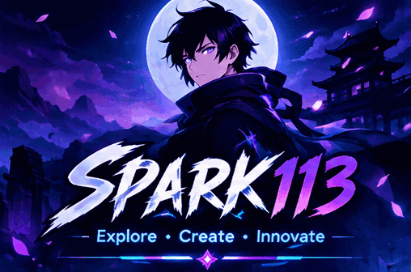
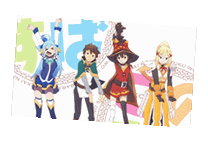
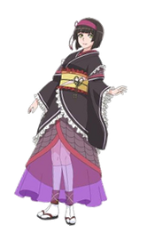
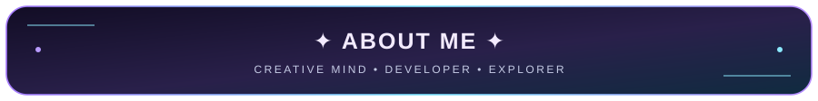
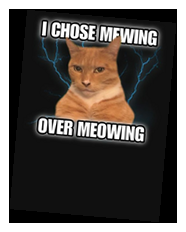
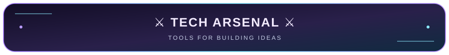
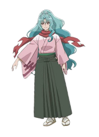
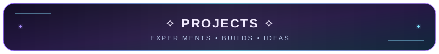
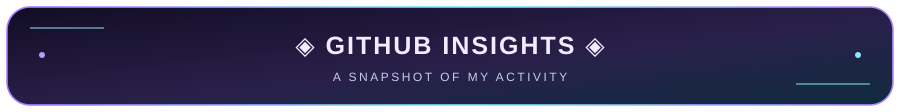
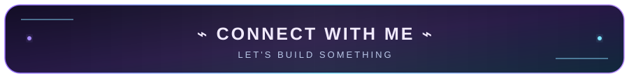

  

 

 
 
**Creative mind • Developer • Explorer**
 
*Turning ideas into reality, one project at a time.*
  

 
 

 

<table>
<tr>
<td align="center" width="50%">

  
**Website Resource Extractor**
 Explore and inspect website resources.
</td>
<td align="center" width="50%">

  
**Something New**
 More experiments coming soon.
</td>
</tr>
</table>

 
 

 Live stats cards are omitted to avoid broken third-party image placeholders.

 
 

 

 

